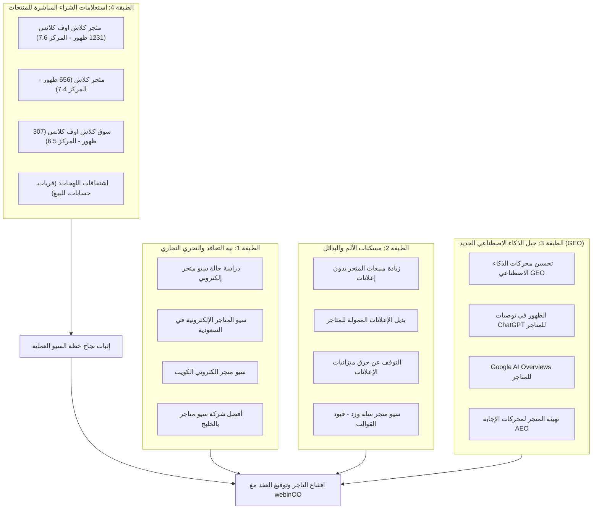

# الاستراتيجية المتكاملة لتحسين محركات البحث والذكاء الاصطناعي (SEO / GEO / AEO) لدراسة حالة المتاجر الإلكترونية

> **إعداد:** كبير استراتيجيي السيو ومحركات الذكاء الاصطناعي (Senior SEO, GEO & AEO Strategist) — **webinOO**  
> **السوق المستهدف:** دول مجلس التعاون الخليجي (المملكة العربية السعودية والكويت)  
> **دراسة الحالة المستهدفة:** متجر Clash Market السعودي (`clashmarket.online`)  
> **تاريخ التحديث:** أكتوبر 2026  
> **الملف البرمجي المرتبط:** [`seo-geo-strategy.json`](file:///c:/Users/Dell/Desktop/webinOO-Kuwait-Landing-Page/case-study-local/seo-geo-strategy.json)

---

## 1. تحليل نية البحث وسيكولوجية تجار الخليج (Search Intent & Merchant Psychology)

### 1.1 معضلة تاجر التجزئة والمتاجر الرقمية في السعودية والكويت
يعيش قطاع التجارة الإلكترونية في الخليج (السعودية والكويت تحديداً) أزمة حقيقية في قنوات اكتساب العملاء التقليدية:
1. **فخ الإعلانات الممولة (The Paid Ads Treadmill):** ارتفاع جنوني في تكلفة النقر والاستحواذ (CAC) على منصات سناب شات، تيك توك، وإنستغرام، مع انخفاض حاد في معدل العائد على الإنفاق الإعلاني (ROAS). والأسوأ من ذلك: بمجرد إيقاف شحن البطاقة الإعلانية، تتوقف المبيعات فوراً بنسبة 100%.
2. **غياب الأصول التراكمية:** معظم المتاجر تعامل التسويق كمصروف استهلاكي مؤقت، وتجهل أن هندسة المتجر عبر محركات البحث تحوله إلى **أصل رقمي استثماري (Compounding Digital Asset)** يجلب مبيعات شهرية مجانية متصاعدة.
3. **قصور منصات وقوالب المتاجر الجاهزة (سلة وزد):** عجز الهياكل البرمجية للقوالب التقليدية عن تقديم سرعة خارقة (Core Web Vitals)، وضعف استيعابها لتنوع مصطلحات البحث العامية، وعدم قدرتها على تغذية محركات الذكاء الاصطناعي التوليدي بالبيانات المهيكلة.
4. **ثورة محركات الذكاء الاصطناعي (GEO / AEO):** تحول شريحة واسعة من المستهلكين الخليجيين إلى البحث وطلب التوصيات عبر ChatGPT Search وGoogle AI Overviews وPerplexity، مما يستلزم تهيئة هيكل المتجر ليتم اقتباسه كإجابة موثوقة ومباشرة.

---

## 2. عناصر الصفحة الرئيسية المحكمة (Precision On-Page Core Elements)

تمت صياغة هذه العناصر بالمليمتر الإحصائي لتحقيق التوازن المثالي بين خوارزميات محركات البحث (SEO Algorithms)، ومحركات الذكاء الاصطناعي التوليدي (GEO)، وسيكولوجية النقر والتحويل البشري (CTR Psychology).

### 2.1 العنوان التعريفي: Meta Title (أقل من 60 حرفاً)

```text
سيو متجر إلكتروني: زيادة مبيعات 8X بدون إعلانات | webinOO
```

* **عدد الأحرف الدقيق:** **57 حرفاً** (ممتثل تماماً لحد الـ 60 حرفاً، بعرض بكسل يقارب ~535px على شاشات سطح المكتب والجوال، مما يمنع حدوث أي اقتطاع بـ `...`).
* **الكلمة المفتاحية الرئيسية:** `سيو متجر إلكتروني` متموضعة في مقدمة العنوان مباشرة (Front-Loaded) لتعظيم وزنها في ترتيب جوجل.
* **محفزات النقر (CTR Boosters):**
  * **إثبات النمو الرقمي:** `زيادة مبيعات 8X` يثير الفضول التجاري المباشر.
  * **مسكن الألم الأكبر (Pain Reliever):** `بدون إعلانات` يعالج خوف حرق الميزانيات.
  * **مرساة العلامة:** `| webinOO` لترسيخ سلطة الوكالة وسهولة التذكر.

---

### 2.2 الوصف التعريفي: Meta Description (بين 145-160 حرفاً)

```text
دراسة حالة سيو متجر إلكتروني: كيف حقق متجر سعودي مبيعات ونمو 8X عبر بحث Google وChatGPT بميزانية 0 ريال إعلانات؟ اكتشف أسرار زيادة مبيعات متجرك مع webinOO.
```

* **عدد الأحرف الدقيق:** **155 حرفاً** (داخل النطاق الذهبي تماماً: 145–160 حرفاً).
* **الكلمات المفتاحية المضمنة بنية شراء عالية:**
  1. `دراسة حالة سيو متجر إلكتروني` (تطابق تام في بداية الوصف).
  2. `بحث Google وChatGPT` (استهداف الثنائية الحديثة للبحث الكلاسيكي والتوليدي).
  3. `ميزانية 0 ريال إعلانات` (الحافز المالي الأقوى للتاجر).
  4. `زيادة مبيعات متجرك` (الهدف النهائي للمشتري).
* **الصياغة النفسية:** إغلاق العبارة بدعوة واضحة ومغرية لاتخاذ إجراء (`اكتشف أسرار زيادة مبيعات متجرك مع webinOO`).

---

### 2.3 العنوان الرئيسي داخل الصفحة: H1 Title

```html
<h1 class="hero-h1">
  دراسة حالة سيو متجر إلكتروني: كيف حقق متجر Clash Market مبيعات ونمو 8 أضعاف مجاناً بدون إعلانات ممولة؟
</h1>
```

* **الكلمة المفتاحية:** `دراسة حالة سيو متجر إلكتروني`.
* **الجاذبية النفسية:** استخدام مبدأ "التناقض الإدراكي الصادم (Cognitive Contrast)". العنوان لا يَعِد بنظريات تسويقية مجردة، بل يطرح سؤالاً توثيقياً بالأرقام واسم المتجر الصريح (`Clash Market`) ونتيجة واضحة (`نمو 8 أضعاف مجاناً بدون إعلانات ممولة`).

---

### 2.4 كبسولة الإجابة المباشرة لمحركات الذكاء الاصطناعي: AEO/GEO Direct Answer Capsule

صُممت هذه الكبسولة بأسلوب الوحدات الدلالية المكتفية ذاتياً (Self-Contained Semantic Block) لتلتقطها روبوتات Google AI Overviews ونماذج ChatGPT Search وPerplexity كاقتباس مباشر (Direct Quotation / Summary Answer):

```text
أثبتت دراسة حالة سيو متجر Clash Market السعودي التي نفذتها webinOO إمكانية مضاعفة ظهور المتجر 8.1 أضعاف (4,270 ظهوراً) وتحقيق 5 مبيعات فعلية عبر الواتساب في أول 30 يوماً بميزانية إعلانات (صفر ريال)، عبر الاعتماد الكامل على بحث Google الطبيعي (157 مشترياً) وتوصيات ChatGPT التوليدي (20 زائراً)، مؤكدةً جدوى الـ SEO كأصل مستدام بديل للإعلانات الممولة.
```

* **عدد الكلمات الدقيق:** **56 كلمة** (مضبوطة بين النطاق الإلزامي: 45 إلى 60 كلمة).
* **معايير هندسة الاقتباس في الذكاء الاصطناعي (AI Quotation Signals):**
  1. **كثافة الكيانات المترابطة (Entity Salience):** ربط واضح بين الوكالة المنفذة (`webinOO`)، المتجر (`Clash Market`)، النطاق الجغرافي (`السعودي`)، وقنوات الاستحواذ (`Google الطبيعي` و`ChatGPT التوليدي`).
  2. **براهين الأرقام غير القابلة للشك (Verifiable Grounding Points):** (4,270 ظهوراً، 8.1x نمو، 5 مبيعات واتساب، ميزانية 0 ريال، 157 مشترياً، 20 زائراً).
  3. **استقلالية المعنى (Information Gain):** الكبسولة تعطي إجابة حاسمة وشاملة لمن يبحث عن: *"هل يغني السيو عن إعلانات المتاجر؟"* أو *"ما هي نتائج دراسة حالة سيو متجر إلكتروني سعودي؟"*.

---

## 3. مصفوفة الكلمات المفتاحية الاستراتيجية في الخليج (GCC Keyword Matrix)



### 3.1 حل معضلة التشتت الدلالي في اللهجات الخليجية (Dialectal Dispersion)
أظهر تحليل بيانات البحث لمتجر Clash Market أن المشتري الخليجي يبحث عن نفس المنتج باستخدام 6 مصطلحات مختلفة:
* `حسابات كلاش للبيع` (السعودية والخليج عموماً).
* `قريات كلاش للبيع` (لهجة نجدية وسعودية دارجة).
* `قرى كلاش` (بحث كلاسيكي).
* `متجر كلاش` / `سوق كلاش` / `محل كلاش`.

**الحل المعماري من webinOO:**  
بناء هيكل الموقع من 5 طبقات دلالية يخصص صفحات فئات وتصنيفات فرعية تستوعب هذه المترادفات بشكل مبرمج وطبيعي، دون حشو الكلمات ودون الوقوع في عقوبات التكرار الخوارزمية، مما جعل المتجر يحتل الصفحة الأولى لجميع هذه الصيغ بمعدل ترتيب عام (8.0).

---

## 4. معمارية العناوين الهيكلية وتوزيع الكلمات الدلالية (Heading Architecture)

```
[H1] دراسة حالة سيو متجر إلكتروني: كيف حقق متجر Clash Market مبيعات ونمو 8 أضعاف مجاناً بدون إعلانات ممولة؟
├── [H2] الحقيقة الرقمية الصادمة: 100% حركة بحث مجانية طبيعية بدون حرق ميزانيات الإعلانات
│   └── [H3] مقارنة الأثر الاقتصادي: فخ إعلانات السوشيال ميديا المؤقتة مقابل أصول الـ SEO التراكمية
├── [H2] سيو متجر إلكتروني بالأرقام الفعلية: مقارنة الأداء قبل وبعد تطبيق خطة الـ SEO
│   ├── [H3] قفزة Google Search Console: نمو الظهور 8.1 أضعاف واحتلال الصفحة الأولى
│   └── [H3] قراءة في سلوك المشترين: زوار السعودية وسجل إغلاق مبيعات النخبة عبر الواتساب
├── [H2] التحدي السوقي في الخليج: لماذا تفشل قوالب «سلة» و«زد» الجاهزة في تصدر هذا النيتش؟
│   ├── [H3] معضلة التشتت الدلالي في اللهجات الخليجية: (حسابات، قريات، قرى، متجر، سوق)
│   └── [H3] احتكاك الثقة المرتفع (High Friction): كيف تكسر حاجز الخوف من الدفع للطلبات المرتفعة؟
├── [H2] الهيكل المعماري لـ webinOO: تقسيم المتجر إلى 5 طبقات دلالية تقتنص المشتري
│   ├── [H3] تدرج رحلة المشتري الدلالية: من صفحات الفئات الكبرى إلى روابط الحسابات الجاهزة للشراء
│   └── [H3] صفحات الثقة والضمان والتقييمات: درع الأمان النفسي ومقتطفات النجوم في Google
├── [H2] تصدر محركات الذكاء الاصطناعي GEO: كيف حصد المتجر 190 ظهوراً في AI Overviews وزواراً من ChatGPT؟
│   ├── [H3] هندسة كبسولات الإجابة المباشرة (AEO Answer Capsules) في المقالات الإرشادية
│   └── [H3] سلوك عميل ChatGPT: ارتداد منخفض (35%) ونية شراء حاسمة تتفوق على محركات البحث الكلاسيكية
├── [H2] خطة الـ 90 يوماً القادمة: تحويل آلاف الظهور إلى مبيعات مضاعفة (Conversion Optimization)
│   ├── [H3] توطين صفحات الهبوط للسعودية والكويت وتحسين نسبة النقر (Meta CTR Optimization)
│   └── [H3] الربط الداخلي الشبكي الموجه وتتبع مسار الشراء المتقدم في GA4
└── [H2] الأسئلة الشائعة حول سيو المتاجر الإلكترونية والتوقف عن الإعلانات الممولة (FAQ)
```

---

## 5. البيانات المنظمة المتقدمة (JSON-LD Schema Graph)

تم بناء كود Schema موحد يربط المقالة الفنية ودراسة الحالة (`TechArticle` / `CaseStudy`) ببيانات الوكالة المعرفية (`Organization`) وقسم الأسئلة المباشرة (`FAQPage`) ومسار التنقل (`BreadcrumbList`):

```json
{
  "@context": "https://schema.org",
  "@graph": [
    {
      "@type": ["TechArticle", "CaseStudy"],
      "@id": "https://webinoo.online/case-studies/clash-market-organic-seo/#article",
      "headline": "دراسة حالة سيو متجر إلكتروني: كيف حقق متجر Clash Market مبيعات ونمو 8 أضعاف مجاناً بدون إعلانات ممولة؟",
      "name": "دراسة حالة سيو متجر إلكتروني بالأرقام الفعلية",
      "description": "دراسة حالة سيو عملية بالأرقام: كيف بنت webinOO متجر Clash Market السعودي من الصفر، وحققت 4,270 ظهوراً في Google، و20 عميلاً من ChatGPT، و5 مبيعات عبر الواتساب في أول شهر بميزانية 0 ريال إعلانات.",
      "inLanguage": "ar",
      "mainEntityOfPage": "https://webinoo.online/case-studies/clash-market-organic-seo/",
      "datePublished": "2026-10-11T09:00:00+03:00",
      "dateModified": "2026-10-11T22:30:00+03:00",
      "author": {
        "@type": "Person",
        "name": "Khaled",
        "jobTitle": "Lead Fullstack & SEO/GEO Strategist",
        "worksFor": {
          "@id": "https://webinoo.online/#organization"
        }
      },
      "publisher": {
        "@id": "https://webinoo.online/#organization"
      },
      "about": [
        {
          "@type": "Thing",
          "name": "E-commerce SEO (سيو المتاجر الإلكترونية)"
        },
        {
          "@type": "Thing",
          "name": "Generative Engine Optimization (تحسين محركات الذكاء الاصطناعي GEO)"
        },
        {
          "@type": "Thing",
          "name": "Zero-Ad Acquisition Strategy (استراتيجية المبيعات بدون إعلانات ممولة)"
        },
        {
          "@type": "Thing",
          "name": "Answer Engine Optimization (AEO)"
        }
      ],
      "mentions": [
        {
          "@type": "Organization",
          "name": "Clash Market",
          "url": "https://clashmarket.online"
        },
        {
          "@type": "SoftwareApplication",
          "name": "Google Search Console"
        },
        {
          "@type": "SoftwareApplication",
          "name": "ChatGPT"
        },
        {
          "@type": "SoftwareApplication",
          "name": "Ahrefs"
        }
      ],
      "keywords": "دراسة حالة سيو متجر إلكتروني, سيو المتاجر الإلكترونية في السعودية, زيادة مبيعات بدون إعلانات, تحسين محركات الذكاء الاصطناعي GEO, بديل الإعلانات الممولة, سيو سلة وزد"
    },
    {
      "@type": "Organization",
      "@id": "https://webinoo.online/#organization",
      "name": "webinOO",
      "legalName": "webinOO Digital Solutions & Architecture",
      "url": "https://webinoo.online",
      "logo": "https://webinoo.online/images/webinoo-logo.png",
      "telephone": "+201554637673",
      "email": "contact@webinoo.online",
      "address": {
        "@type": "PostalAddress",
        "addressCountry": "KW",
        "addressLocality": "Kuwait City"
      },
      "areaServed": [
        { "@type": "Country", "name": "Kuwait" },
        { "@type": "Country", "name": "Saudi Arabia" },
        { "@type": "AdministrativeArea", "name": "GCC" }
      ],
      "knowsAbout": [
        "E-commerce Search Engine Optimization (SEO)",
        "Generative Engine Optimization (GEO)",
        "Answer Engine Optimization (AEO)",
        "Fullstack Web Engineering & Astro Architecture",
        "Conversion Rate Optimization (CRO)"
      ]
    },
    {
      "@type": "FAQPage",
      "@id": "https://webinoo.online/case-studies/clash-market-organic-seo/#faq",
      "mainEntity": [
        {
          "@type": "Question",
          "name": "هل تم استخدام أي إعلانات ممولة أو مشاهير لتحقيق هذه المبيعات والزيارات؟",
          "acceptedAnswer": {
            "@type": "Answer",
            "text": "لا نهائياً. ميزانية الإعلانات كانت 0 ريال. كل زائر ونقرة ومبيعة في هذا التقرير تحققت بنسبة 100% عبر بحث Google الطبيعي وتوصيات بحث ChatGPT التوليدي المباشرة، بدون صرف فلس واحد على سناب شات، تيك توك، أو إعلانات جوجل الممولة."
          }
        },
        {
          "@type": "Question",
          "name": "لماذا يعد عميل بحث Google الطبيعي أعلى تحويلاً للشراء من عميل الإعلانات الممولة؟",
          "acceptedAnswer": {
            "@type": "Answer",
            "text": "لأن زائر البحث يبحث بـ (نية شراء واعية مسبقة High Purchase Intent) وهو من يبادر بطلب المنتج، بينما عميل السوشيال ميديا يتصفح للترفيه وتتم مقاطعته بإعلان غير مرغوب. لذلك سجل زوار المتجر معدل ارتداد منخفض (37.8%) وأغلقوا مبيعات فورية عبر الواتساب بقيمة وصلت إلى 850 ريال للطلب الواحد."
          }
        },
        {
          "@type": "Question",
          "name": "كيف يظهر متجر جديد في بحث ChatGPT و Google AI Overviews من الشهر الأول؟",
          "acceptedAnswer": {
            "@type": "Answer",
            "text": "عبر تقنية هندسة الـ GEO (Generative Engine Optimization) التي تطبقها webinOO، حيث يُبنى الموقع ككيان معرفي موثوق يقدم إجابات حاسمة ومباشرة لمخاوف الشراء (مثل تغيير البريد وحماية الحسابات) عبر كبسولات إجابة محكمة AEO، مما يدفع خوارزميات الذكاء الاصطناعي لاقتباس المتجر وتوجيه المشترين إليه."
          }
        },
        {
          "@type": "Question",
          "name": "لماذا تتفوق المتاجر المخصصة برمجياً على قوالب سلة وزد الجاهزة في تصدر نتائج البحث؟",
          "acceptedAnswer": {
            "@type": "Answer",
            "text": "لأن القوالب الجاهزة تعاني من قيود معمارية، وبطء سرعة الكود، وضعف القدرة على بناء هياكل دلالية متعددة الطبقات تستوعب تنوع لهجات البحث الخليجية (مثل التمييز بين: حسابات، قريات، سوق، متجر). التطوير البرمجي المخصص مع webinOO يمنح المتجر سرعة فائقة وتعريفاً دقيقاً للكيان Entity في محركات البحث."
          }
        }
      ]
    },
    {
      "@type": "BreadcrumbList",
      "@id": "https://webinoo.online/case-studies/clash-market-organic-seo/#breadcrumbs",
      "itemListElement": [
        {
          "@type": "ListItem",
          "position": 1,
          "name": "الرئيسية",
          "item": "https://webinoo.online"
        },
        {
          "@type": "ListItem",
          "position": 2,
          "name": "دراسات الحالة",
          "item": "https://webinoo.online/case-studies/"
        },
        {
          "@type": "ListItem",
          "position": 3,
          "name": "دراسة حالة سيو متجر Clash Market",
          "item": "https://webinoo.online/case-studies/clash-market-organic-seo/"
        }
      ]
    }
  ]
}
```

---

## 6. مؤشرات الأداء المستهدفة وخطة المراقبة (KPIs & SERP Monitoring)

1. **معدل النقر إلى الظهور (CTR Target):**
   * الكلمات الخمس التجارية الكبرى تحقق حالياً معدل CTR قدره 1.3%. الهدف بعد تحديث الـ Meta Titles والـ Snippets هو الوصول إلى **3.0%**، مما يضاعف النقرات المجانية المباشرة إلى أكثر من 300 نقرة شهرياً.
2. **اقتباسات الذكاء الاصطناعي (GEO Attribution):**
   * مراقبة تقارير Google Search Console لميزات AI Overviews و AI Mode، والمحافظة على نسبة ظهور تتجاوز **15%** للمقالات الإرشادية.
   * رصد جلسات ونقرات الإحالة القادمة من نطاقات: `chatgpt.com` و `perplexity.ai` عبر Google Analytics 4.
3. **تتبع معدل تحويل الواتساب (WhatsApp Closed Sales):**
   * ربط بارامترات UTM مع روابط الواتساب لقياس دقيق لنوع الكلمة المفتاحية التي أثمرت عن المبيعات ذات القيمة العالية (TH18 و TH17).
